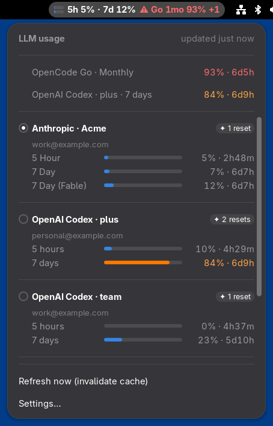

# oh-my-usage

[omp](https://github.com/can1357/oh-my-pi) に登録した LLM アカウントの利用上限を、GNOME のトップバーか macOS のメニューバーに出す。`omp usage --json` を定期的に実行し、全アカウントの使用率とリセットまでの残り時間を一覧する。GNOME では GNOME Shell 拡張として、macOS ではメニューバーに常駐するアプリとして動く。



## GNOME

### 必要なもの

- GNOME Shell 50 か 51
- `omp usage --json` が動くこと。auth broker 経由の構成でもよい。

### インストール

```sh
git clone https://github.com/ymkthr/oh-my-usage
cd oh-my-usage
make install
```

`make install` は `dist/` に拡張の zip を作り、`gnome-extensions install --force` で `~/.local/share/gnome-shell/extensions/` に入れる。Wayland の GNOME Shell は動作中に入った拡張を読み込まないので、ログアウトしてログインし直してから有効にする。

```sh
gnome-extensions enable oh-my-usage@ymkthr.github.io
```

更新するときも、`git pull` と `make install` のあとに再ログインが要る。外すときは `make uninstall` を実行する。

## macOS

### 必要なもの

- macOS 14 以降。Apple シリコンと Intel のどちらでも動く。
- `omp usage --json` が動くこと。

### インストール

```sh
brew install --cask ymkthr/tap/oh-my-usage
open /Applications/oh-my-usage.app
```

Dock には出ず、メニューバーにだけ出る。ログイン時に起動させたいときは、システム設定の「一般」→「ログイン項目」に `oh-my-usage.app` を加える。

アプリは Apple の公証を受けていない。そのままだと初回起動で Gatekeeper に止められるので、cask はインストール時に隔離属性 (`com.apple.quarantine`) を外している。

omp は `~/.bun/bin/omp` にあるものとして実行する。Finder から起動したアプリはシェルの `PATH` を引き継がないためだ。別の場所に入れているなら、メニューの「Settings…」でパスを指定する。

更新は `brew upgrade --cask oh-my-usage`、削除は `brew uninstall --cask oh-my-usage` で行う。どちらも動いているアプリを終了させる。設定も消すなら `--zap` を付ける。

ソースからビルドするなら、Xcode を入れたうえでリポジトリを clone し、`make mac-install` を実行する。`~/Applications/` に入って起動する。

## ライセンス

MIT
